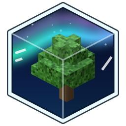
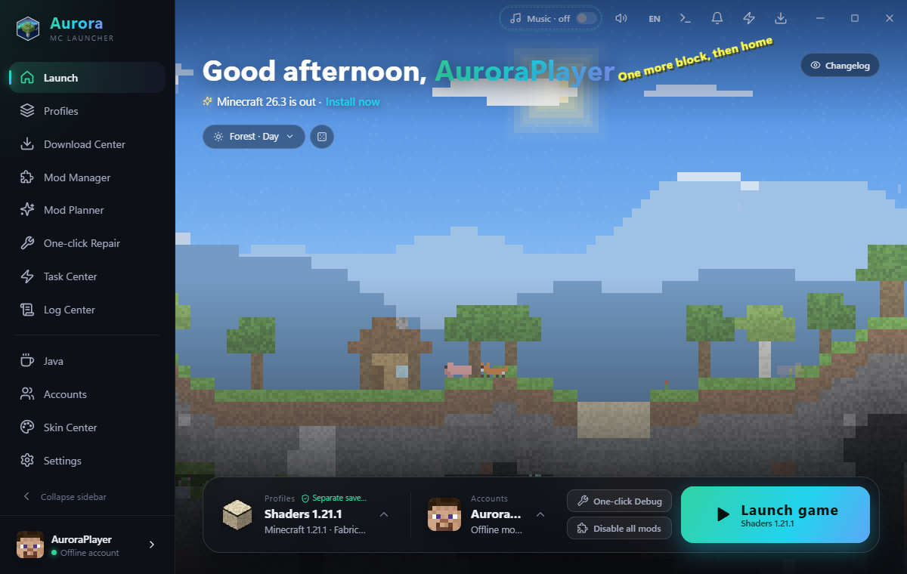
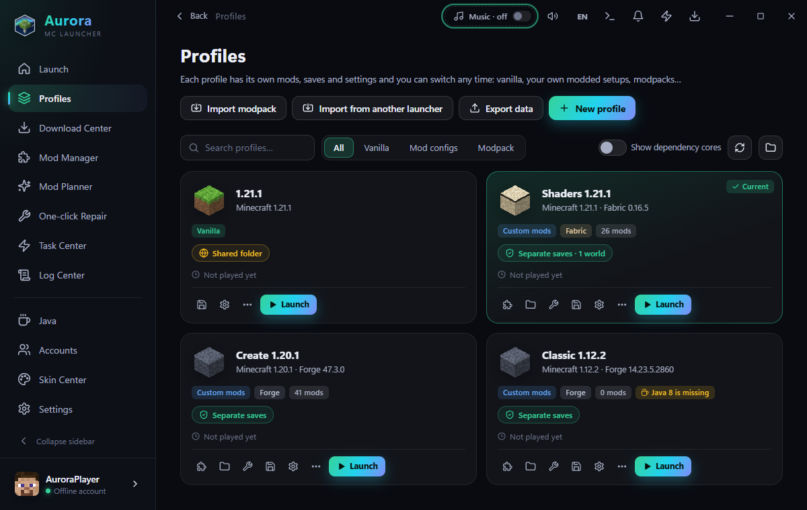
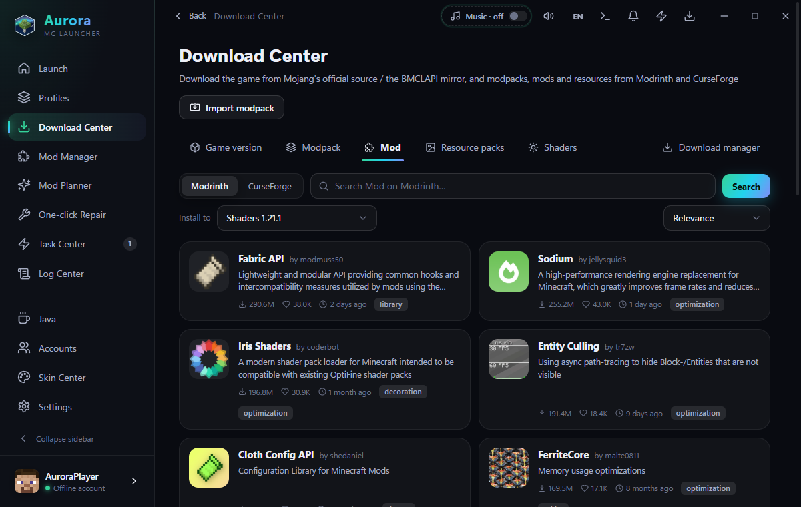
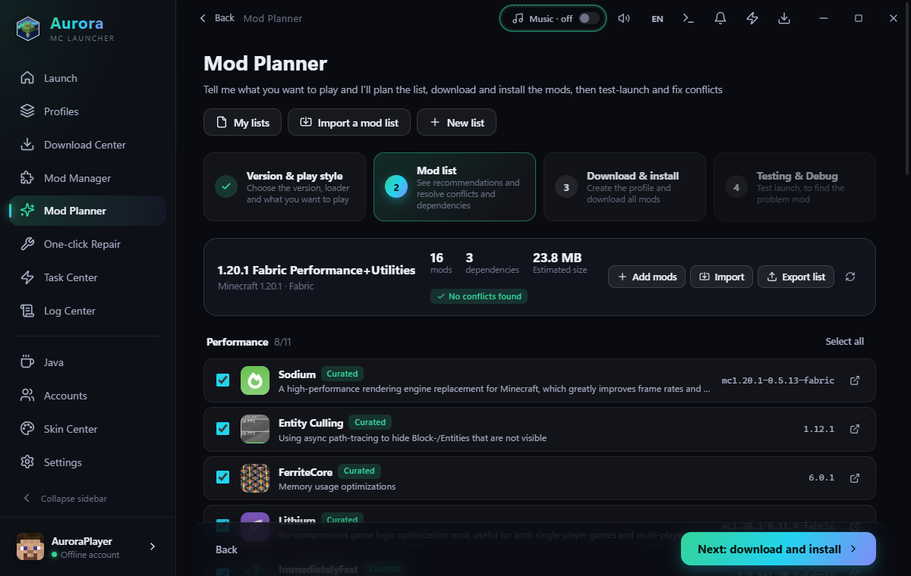
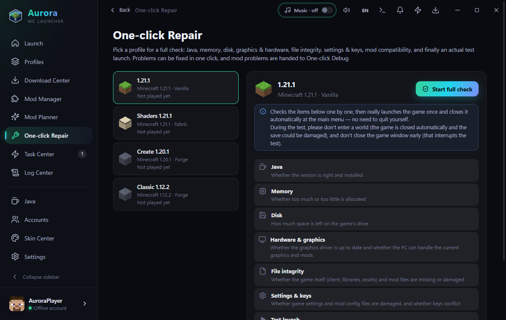
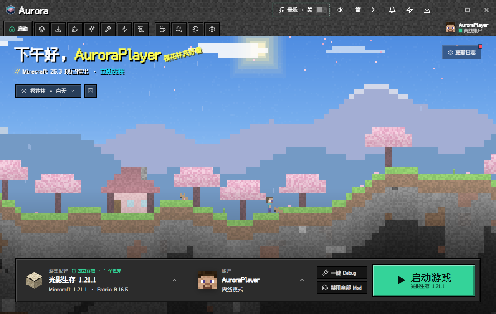
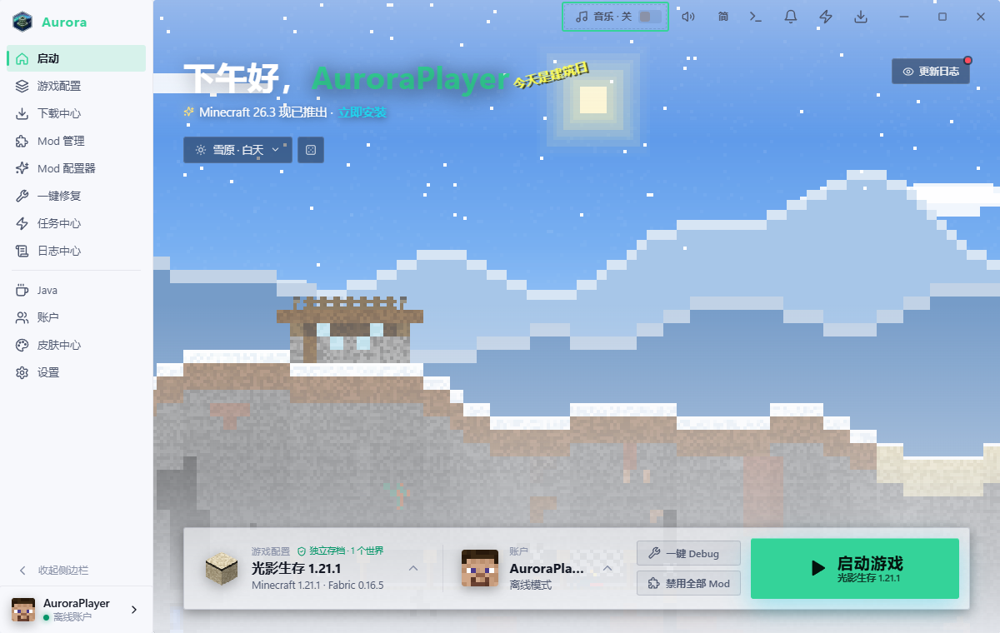
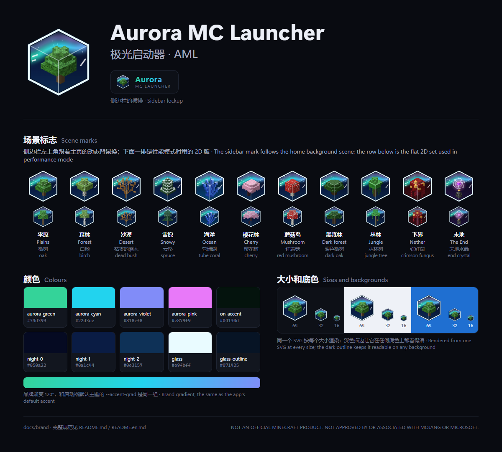

<p align="center"></p>

# Aurora MC Launcher (极光启动器)

[简体中文](README.md)

A Minecraft: Java Edition launcher for Windows. One exe, nothing to install: download the game, install mods, set up modpacks and track down crashes, all in one window.

**Promo video** (in Chinese, on Bilibili): [see what Aurora MC Launcher can do](https://www.bilibili.com/video/BV1iNyLzcEwT/)

> **NOT AN OFFICIAL MINECRAFT PRODUCT. NOT APPROVED BY OR ASSOCIATED WITH MOJANG OR MICROSOFT.**
> Aurora MC Launcher is an unofficial third-party launcher made by an individual developer. It has no connection with Mojang or Microsoft.



## Download

Get the latest `Aurora-MC-Launcher-<version>-Portable.exe` from [Releases](https://github.com/213LD/Aurora-MC-Launcher/releases), put it in any folder and double-click it.

- Windows 10 / 11 (64-bit)
- No installer and no runtimes to install. You need a network connection the first time you download the game and Java; after that the launcher opens and your installed games run offline too.
- The exe is not code-signed, so Windows may say "Windows protected your PC" the first time: click "More info", then "Run anyway".
- Only download from this repository's Releases. We can't vouch for copies from anywhere else (file-sharing sites, group chats, modified builds).

The interface is available in Simplified Chinese and English. A few features exist only in the Chinese interface, such as Chinese mod names and searching mods in Chinese.

## Features

### Profiles: every profile has its own mods, saves and settings

Keep vanilla, your own modded setups and modpacks apart, and switch with one click. Saves can be separate per profile or shared between profiles. A "Test copy" duplicates your saves before the game starts, so trying a new mod or game version never touches the original world.



### Download Center

- The game: Mojang's official servers or the BMCLAPI mirror; the launcher picks the faster one and switches when a download stalls
- Loaders: one-click install of Fabric, Quilt, Forge, NeoForge and OptiFine
- Mods, modpacks, resource packs and shaders: search and download from Modrinth and CurseForge, with required dependencies added automatically
- Java: finds the Java already on your computer and downloads the right version when one is missing



### Mod Planner: say what you want to play, get a whole setup

Pick a game version, a loader and what you want to play (performance, shaders, tech, magic, adventure…). The planner builds a list of curated and popular mods, adds the dependencies and flags conflicts. Confirm it and the planner downloads everything, creates the profile and test-launches it once.



### One-click Repair and One-click Debug

- One-click Repair checks Java, memory, disk space, graphics and hardware, file integrity, and game settings and key bindings, then really launches the game to see whether it reaches the main menu
- One-click Debug reads the loader's errors, installs missing dependencies and turns off conflicting mods. If that isn't enough, it bisects: it switches half of the mods off at a time until it finds the one causing the problem. Every step can be undone
- After a crash, the launcher tells you the likely cause and what to do about it



### Three interface styles

The default "Aurora" style, a pixel style in the spirit of the game, and a compact style, each with dark and light themes. Accessibility settings include interface zoom, large text, high contrast, reduced motion, no flashing and colour-vision aids.

| Pixel | Compact (light) |
|---|---|
|  |  |

### And more

- **Move in from other launchers**: import profiles and saves from the official launcher, HMCL, PCL2 and MultiMC / Prism Launcher; the original files are never changed
- **Accounts**: Microsoft sign-in (device code flow, through the launcher's built-in Azure app approved by Microsoft), third-party sign-in (LittleSkin and others), and offline accounts. Offline accounts can use your own skin through the launcher's built-in local skin server
- **Skin Center**: collect, group and preview skins in 3D, and assign them to offline accounts
- **Log Center**: watch the game log live, filter by level, search and export; the log of every session is kept
- **Your data, your choice of location**: the system default, portable mode (everything lives in a folder next to the exe, so you can copy the whole folder elsewhere), or a folder you pick
- **A living home screen**: pixel-art plains, forests, deserts, snowy plains, cherry groves, the Nether, the End… with day and night, weather and mobs, plus ten original background tracks synthesised live by the launcher

## Privacy

- The launcher collects no data: no analytics, no telemetry, nothing about you is uploaded, and it has no server of its own.
- The launcher doesn't check for updates. Download new versions from this repository's Releases.
- It only goes online when you use a feature that needs it, and then talks directly to that service: downloading (and searching) the game, mods, resource packs, shaders and Java; Microsoft and third-party sign-in; Minecraft news on the home screen; importing a skin by player name, from LittleSkin or from a URL.
- Everything else works without a network. When the network is gone, the launcher switches to offline mode and disables the features that need it.

## Notes

- Windows only.
- Online features (downloading games/mods, Microsoft sign-in, and third-party sign-in) are disabled in offline mode.

## Running from source

You need [Node.js](https://nodejs.org/) 22 or later, on Windows.

```bash
npm install
npm start
```

If Electron wasn't downloaded during `npm install`, run `node node_modules/electron/install.js`.

```bash
npm test          # regression tests (unit tests, UI checks, pitfall checks and more)
npm run dist      # build dist/Aurora-MC-Launcher-<version>-Portable.exe
```

## Tech stack

- **Electron 44** with plain JavaScript in the UI: no frontend framework, no build step, and no third-party runtime dependencies (`package.json` has just two dev dependencies: Electron and the electron-builder packager)
- Downloading, zip handling, NBT, reading mod metadata and the local Yggdrasil skin server are all written on Node.js built-in modules
- The home screen's pixel scene is drawn with Canvas 2D; the background music is synthesised live with Web Audio
- The test scripts drive the real launcher window over the Chrome DevTools Protocol (CDP): clicking buttons, measuring layout and comparing screenshots

## File map

```
src/
  main/                main process
    engine/            engine: settings, safe file I/O, downloads, mirrors, tasks, zip, nbt (knows nothing about features)
    core/              features: versions and loaders, launching, Java, profiles and isolation, saves and backups,
                       mods and modpacks, Mod Planner, One-click Repair (troubleshoot/), accounts (auth/), skins, migration
    ipc/               the bridge between the main process and the UI (forwarding only)
  renderer/            the UI
    js/base/           UI foundations: elements, dialogs, menus, toasts, translation of the English interface
    js/pages/          the pages: home, profiles, Download Center, Mod Manager, Mod Planner, One-click Repair…
    js/scene/          the home screen's pixel scene: world generation, mobs, weather, water and lava
    css/               styles; styles/ holds the pixel and compact styles
  shared/              shared by the main process and the UI: names, version numbers, text (i18n/)
scripts/               packaging and checks; regress/ holds the regression tests
```

The layers are enforced: `engine` may not depend on `core`, and `core` may not depend on the UI. The layer check in `npm test` blocks it.

Most code comments and the interface source text are in Chinese; the English interface is produced from `src/shared/i18n/tr-en.js`.

## Logo and visual identity

The logo is a glass block holding an aurora night sky with an oak tree growing inside. The sidebar mark follows the home background scene (11 of them) and turns into a flat 2D version in performance mode. The name, colours, type, drawing rules and don'ts are in [docs/brand](docs/brand/README.en.md).

<p align="center"><a href="docs/brand/README.en.md"></a></p>

## How this project was made

The code, the interface and the background music were written by an AI (Claude). The requirements, the design decisions and round after round of hands-on testing were done by the author, 213LD.

This repository is exported from the author's private development repository, so its commit history starts at the public release. Version numbers in code comments (such as `1.10.7` or `2.0.0-rc9`) are internal version numbers from before the public release; public versions start again from 1.0.0 (the first Release in this repository is 1.1.1).

## Credits

[ACKNOWLEDGEMENTS.md](ACKNOWLEDGEMENTS.md) (in Chinese; the same list as "Settings → About → References & Acknowledgements" in the launcher) states, feature by feature, how this launcher relates to similar features in other launchers: an implementation approach we referred to, an idea that inspired us, or an independent implementation of a similar feature. **Referring to something is not copying it**: no code or data from HMCL, PCL2 or other launchers was copied, and the Chinese mod-name table was compiled for this project. The online services we use (Mojang, BMCLAPI, Modrinth, CurseForge and others) and the third-party works with their licenses are listed there too.

## Issues and feedback

Please use [Issues](https://github.com/213LD/Aurora-MC-Launcher/issues). When reporting a crash, attaching that session's log from the Log Center helps a lot.

## License

Copyright (C) 2026 213LD

This project is licensed under the [GNU General Public License, version 3](LICENSE) or (at your option) any later version (GPL-3.0-or-later). If you distribute this project or a modified version, keep the copyright notice and the license and provide the complete source code under the same license; modified versions must carry prominent notices stating that they were changed.

Minecraft is a trademark of Mojang Studios. The launcher doesn't include or distribute any Minecraft game files; they are downloaded from Mojang's servers (or the mirror you choose) when you play. The full disclaimer is in the launcher under "Settings → About → Disclaimer", and a copy, `免责声明.txt`, is written next to the program the first time it runs.
