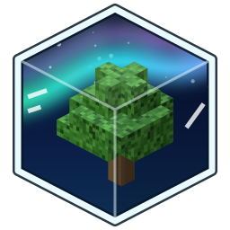
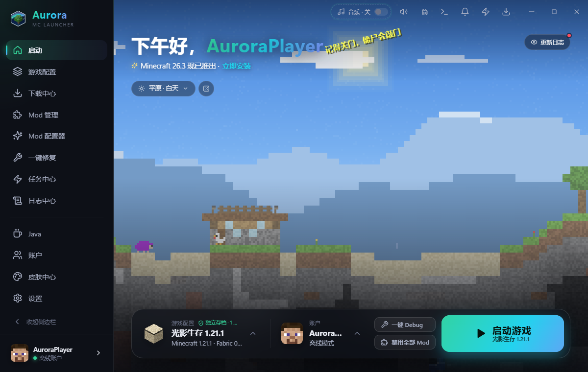
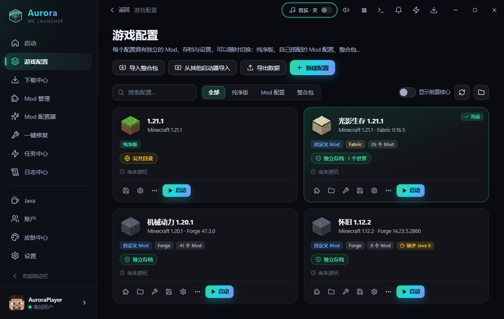
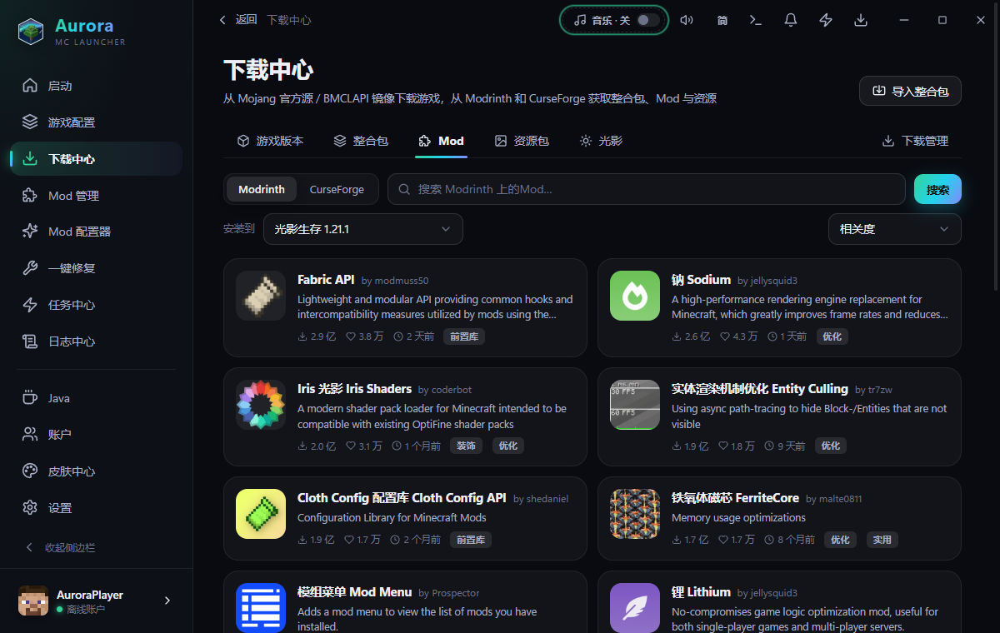
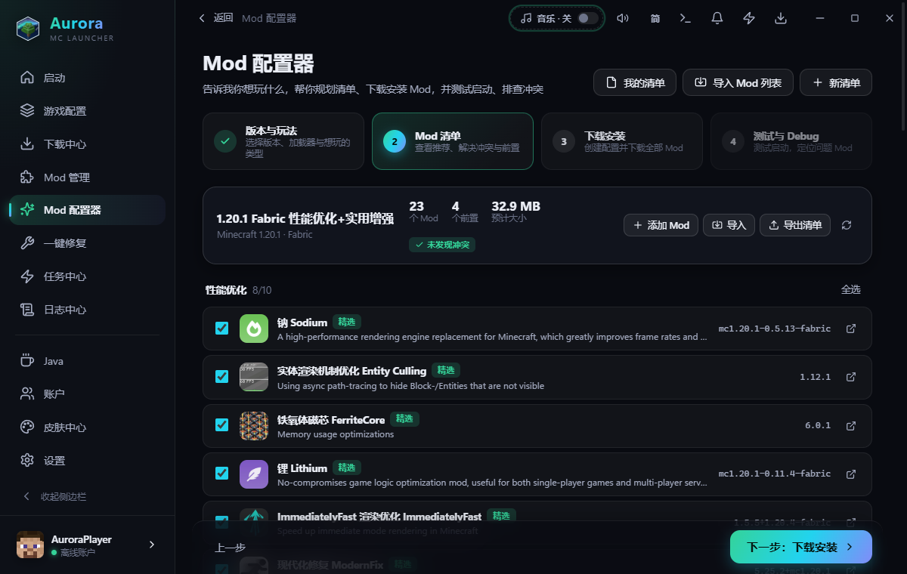
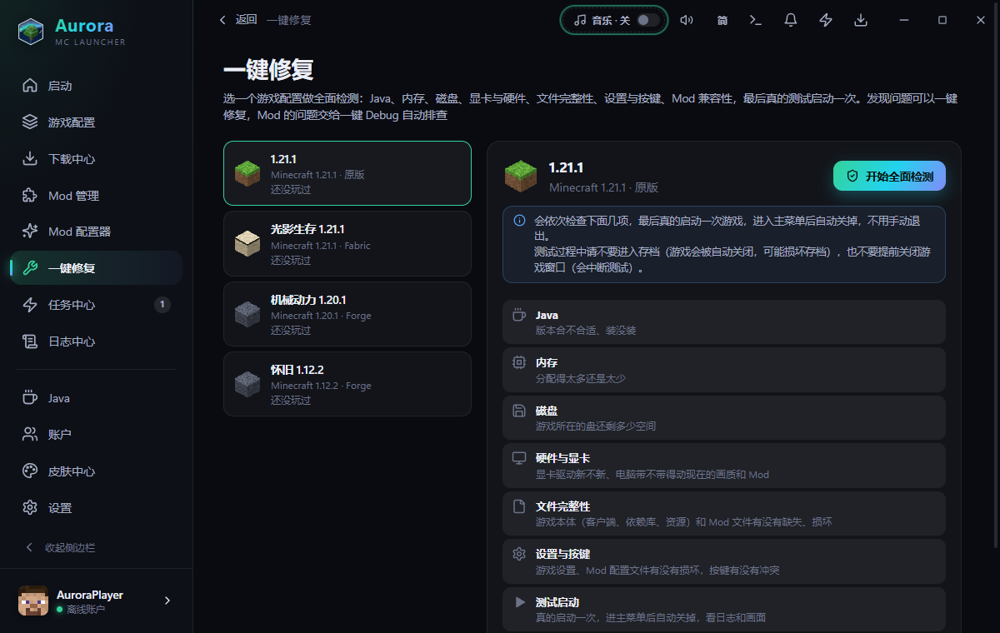
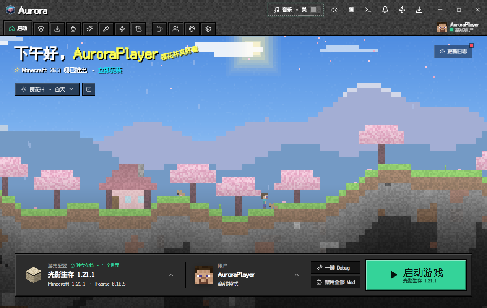
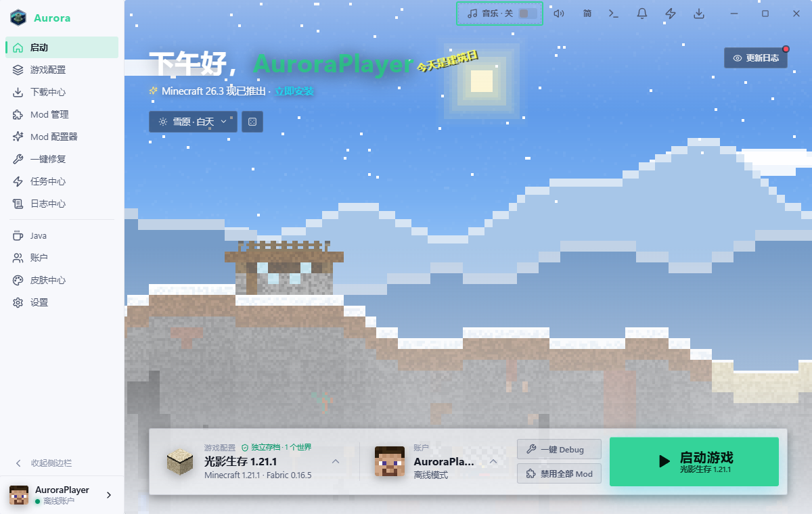

<p align="center"></p>

# 极光启动器 Aurora MC Launcher

[English](README.en.md)

Windows 上的 Minecraft Java 版启动器。一个 exe，不用安装，双击就能用：下游戏、装 Mod、配整合包、查崩溃，都在一个窗口里。

> **NOT AN OFFICIAL MINECRAFT PRODUCT. NOT APPROVED BY OR ASSOCIATED WITH MOJANG OR MICROSOFT.**
> 极光启动器是个人开发的非官方第三方启动器，和 Mojang、Microsoft 没有任何关系。



## 下载

到 [Releases](https://github.com/213LD/Aurora-MC-Launcher/releases) 下载最新的 `Aurora-MC-Launcher-<版本>-Portable.exe`，放到哪个文件夹都行，双击运行。

- 系统：Windows 10 / 11（64 位）
- 不用安装，也不用装任何运行库。第一次下载游戏和 Java 需要联网；下好以后没网也能打开、照样玩。
- exe 没有数字签名，第一次打开时 Windows 可能提示「Windows 已保护你的电脑」：点「更多信息」→「仍要运行」。
- 只从这个仓库的 Releases 下载。别处（网盘、群文件、改过的版本）拿到的，我们没法保证没被改过。

## 有什么

### 游戏配置：每个配置一套自己的 Mod、存档和设置

纯原版、自己搭的 Mod 配置、整合包分开放，一键切换。存档可以每个配置独立，也可以几个配置共享；「测试副本」先复制一份存档再进游戏，试新 Mod、新版本不会弄坏原来的世界。



### 下载中心

- 游戏本体：Mojang 官方源和 BMCLAPI 国内镜像，自动选快的那个，下不动自动换
- 加载器：Fabric、Quilt、Forge、NeoForge、OptiFine 一键安装
- Mod、整合包、资源包、光影：从 Modrinth 和 CurseForge 搜索下载，前置 Mod 自动补上
- Mod 有中文名，可以用中文和常用缩写搜（比如「钠」「JEI」「机械动力」）
- Java：自动找电脑上已经装的，缺了自动下载合适的版本



### Mod 配置器：说想玩什么，配好一整套

选游戏版本、加载器和想玩的方向（性能优化、光影、科技、魔法、冒险……），配置器给出一份清单：精选的和热门的 Mod、自动补齐的前置、互相冲突的提示。确认以后一键下载、建好配置，再测试启动一次。



### 一键修复和一键 Debug

- 一键修复：Java、内存、磁盘、显卡和硬件、文件完整性、设置和按键都查一遍，最后真的启动一次游戏看能不能进主菜单
- 一键 Debug：读加载器的报错，自动补前置、关掉冲突的 Mod；还找不到就二分排查，一半一半地关，找出是哪个 Mod 出的问题。每一步都能撤销
- 崩溃以后直接告诉你大概是什么原因、该怎么办



### 三种界面风格

默认的「极光」，像素原版风格，紧凑风格；都有深色和浅色。还有无障碍设置：界面缩放、大字号、高对比度、减少动态效果、防闪烁、色觉辅助。

| 像素原版 | 紧凑（浅色） |
|---|---|
|  |  |

### 还有

- **从别的启动器搬过来**：从官方启动器、HMCL、PCL2、MultiMC / Prism Launcher 导入游戏配置和存档，原来的文件不会被改
- **账户**：离线账户、外置登录（LittleSkin 等）；离线账户也能用自己的皮肤（启动器自带本地皮肤服务）。微软正版登录还在开发，见下面「还没做完的」
- **皮肤中心**：收藏、分组、3D 预览皮肤，分配给不同的离线账户
- **日志中心**：实时看游戏日志，按级别过滤、搜索、导出；每次游戏的日志都留着
- **数据放哪你定**：系统默认位置、便携模式（所有东西都放在 exe 旁边的文件夹里，整个文件夹能直接拷走）、或者自己选的文件夹
- **会动的主页**：像素风的平原、森林、沙漠、雪原、樱花林、下界、末地……有昼夜、天气和各种生物；还有十首原创背景音乐，由启动器实时合成
- **界面语言**：简体中文和英语

## 隐私

- 启动器不收集任何数据：没有统计、没有遥测、不上传你的任何信息，也没有自己的后台服务器。
- 启动器不检测版本更新。新版本请到这个仓库的 Releases 自己下载。
- 只有你用到这些功能时才会联网，而且直接连对应的服务：下载游戏、Mod、资源包、光影和 Java（以及搜索它们）；微软正版登录和外置登录；主页的 Minecraft 新闻；按正版玩家名、LittleSkin 或网址导入皮肤。
- 其他功能都不需要网络；断网时启动器会自动切换到离线模式，需要联网的功能先停用。

## 还没做完的

- **微软正版登录**：代码写好了，但微软要求第三方启动器用自己在 Azure 注册的应用登录，还要单独申请 Minecraft 接口权限。申请批下来之前，入口显示「正在开发」，请先用离线账户或外置登录。
- 只支持 Windows。

## 从源码运行

需要 [Node.js](https://nodejs.org/)（22 或更新）和 Windows。

```bash
npm install
npm start
```

如果 `npm install` 以后 Electron 没有自动下载下来，运行 `node node_modules/electron/install.js`。

```bash
npm test          # 回归测试（单元测试、界面检查、踩坑检查等）
npm run dist      # 打包，得到 dist/Aurora-MC-Launcher-<版本>-Portable.exe
```

## 技术栈

- **Electron 44**，界面是原生 JavaScript：没有前端框架、没有构建步骤，运行时没有第三方依赖（`package.json` 里只有 Electron 和打包工具 electron-builder 两个开发依赖）
- 下载、解压 zip、读 NBT、读 Mod 信息、Yggdrasil 本地皮肤服务……都用 Node.js 自带的模块自己实现
- 主页的像素场景用 Canvas 2D 画，背景音乐用 Web Audio 实时合成
- 测试脚本通过 Chrome 调试协议（CDP）操作真实的启动器窗口：点按钮、量布局、截图对比

## 文件地图

```
src/
  main/                主进程
    engine/            引擎：设置、文件安全读写、下载、镜像、任务、zip、nbt（不认识任何具体功能）
    core/              功能：版本和加载器、启动、Java、配置和隔离、存档备份、Mod 和整合包、
                       Mod 配置器、一键修复（troubleshoot/）、账户（auth/）、皮肤、迁移
    ipc/               主进程和界面之间的接口（只转发）
  renderer/            界面
    js/base/           界面底层：元素、弹窗、菜单、提示、英文界面的翻译
    js/pages/          各个页面：主页、游戏配置、下载中心、Mod 管理、Mod 配置器、一键修复……
    js/scene/          主页的像素场景：世界生成、生物、天气、水和岩浆
    css/               样式；styles/ 里是像素原版和紧凑两种风格
  shared/              主进程和界面共用：名字、版本号、文字（i18n/）
scripts/               打包、各种检查；regress/ 是回归测试
```

分层是强制的：`engine` 不能依赖 `core`，`core` 不能依赖界面，`npm test` 里的分层检查会拦。

## 这个项目是怎么做出来的

代码、界面和背景音乐都是 AI（Claude）写的；需求、设计上的决定和一轮轮的试用测试，是作者 213LD 做的。

这个仓库是从作者的私人开发仓库导出的，提交历史从公开时开始。代码注释里出现的版本号（例如 `1.10.7`、`2.0.0-rc9`）是公开之前的内部版本号，公开版从 1.0.0 重新算。

## 参考与致谢

和其他启动器相似的功能，在 [ACKNOWLEDGEMENTS.md](ACKNOWLEDGEMENTS.md)（启动器里「设置 → 关于 → 参考与致谢」是同一份）里逐条写清楚了：是参考了实现思路、只是受了启发，还是独立实现、功能相似。**参考不等于复制**：没有复制 HMCL、PCL2 等启动器的代码和数据；Mod 中文名对照表是本项目自己整理的。用到的在线服务（Mojang、BMCLAPI、Modrinth、CurseForge 等）、第三方作品和它们的许可证也都列在里面。

## 问题和反馈

到 [Issues](https://github.com/213LD/Aurora-MC-Launcher/issues) 提。报崩溃时附上日志中心里那一局的日志会快很多。

## 许可证

Copyright (C) 2026 213LD

本项目以 [GNU 通用公共许可证第 3 版](LICENSE)或（由你选择）任何更新的版本发布（GPL-3.0-or-later）。分发本项目或修改后的版本时，要保留版权声明和许可证，并按同一许可证提供完整源代码；修改后的版本要醒目地注明改过。

Minecraft 是 Mojang Studios 的商标。启动器不包含、也不分发 Minecraft 的游戏文件，游戏文件都是玩的时候从 Mojang 的服务器（或你选的镜像）下载的。完整的免责声明在启动器里「设置 → 关于 → 免责声明」，第一次运行时也会在程序旁边生成 `免责声明.txt`。
