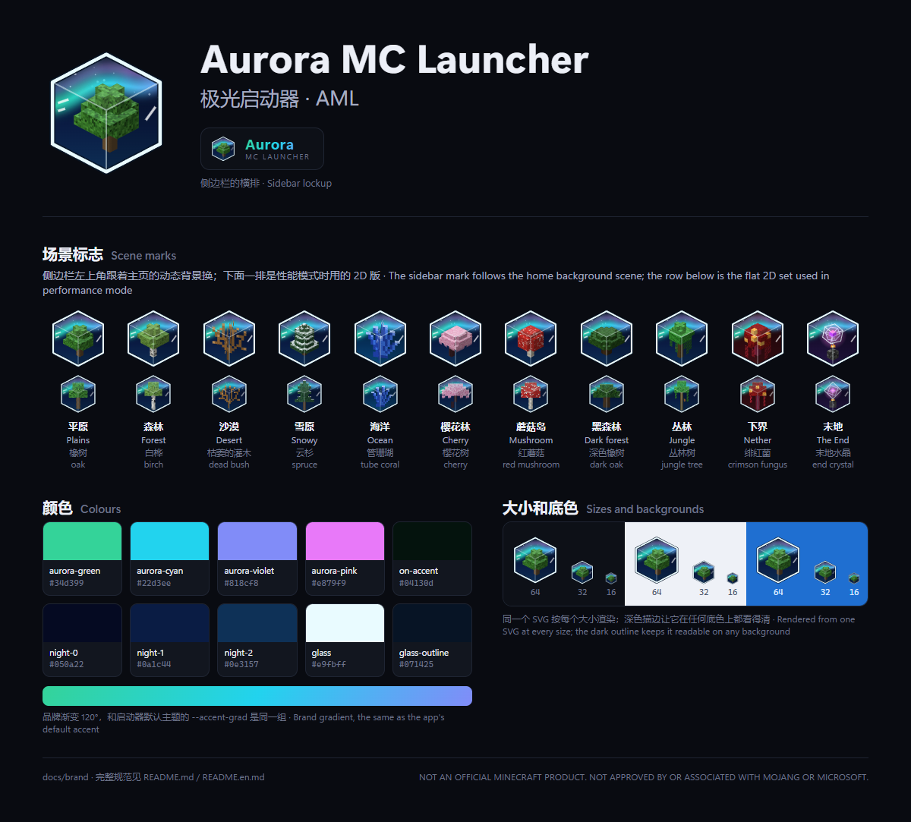

# Logo and visual identity

[中文](README.md)

How to use the Aurora MC Launcher logo, name, colours and type. The palette is the same one the launcher's interface uses.

| File | What it is |
|---|---|
| [`aml-mark.svg`](aml-mark.svg) | The main mark (3D oak) |
| [`aml-mark-2d.svg`](aml-mark-2d.svg) | The 2D version of the main mark |
| [`../../src/renderer/img/brand/`](../../src/renderer/img/brand/) | The 11 scene marks `scene-<scene>.svg` and their 2D versions `scene-<scene>-2d.svg` |
| [`tokens.json`](tokens.json) | Colours, type, spacing, radii, shadows and mark sizes, each with where it is used (descriptions in Chinese) |
| [`vi-sheet.png`](vi-sheet.png) | The overview image above |
| [`../../scripts/brand-icons.js`](../../scripts/brand-icons.js) | Draws the program icon `src/main/brand/icon.ico` from `aml-mark.svg` (`npm run icons`) |

## Name

- The full name is **Aurora MC Launcher**, the short form is **AML**, and the Chinese name is **极光启动器**. All three are official; use whichever fits the place. The older names Aurora Minecraft Launcher and Aurora Launcher are no longer used (the launcher only uses them to find data folders created under those names).
- The sidebar shows only `Aurora` (`wordmark`) with the tagline `MC LAUNCHER` (`tagline`). The README, release pages and window title use the full name.
- Never put the names or logos of Minecraft, Mojang or Microsoft into our logo or name. When the relationship needs explaining, use the disclaimer sentence: NOT AN OFFICIAL MINECRAFT PRODUCT. NOT APPROVED BY OR ASSOCIATED WITH MOJANG OR MICROSOFT.

## What the logo means

A glass block holding an aurora night sky, with a tree growing in the middle: **an aurora caught in a block**. Glass is the most ordinary block in Minecraft, the aurora is the name, and the tree is a little world inside the block. The logo is its own icon shape (an isometric hexagon outline), with no rounded-rectangle plate behind it.

## Main mark

- Use `aml-mark.svg`, the 3D oak, for the exe, window title bar, taskbar, tray, desktop shortcut, README and release pages. **3D is always the default.**
- Do not use a scene mark or a 2D version as the program icon.

## Scene marks in the sidebar

The mark at the top left of the sidebar (34 px) follows the home screen's animated background:

| Scene | File | Plant |
|---|---|---|
| Plains; any background that is not a scene (image, solid colour) | `scene-plains.svg` (same as the main mark) | Oak |
| Forest | `scene-forest.svg` | Birch |
| Desert | `scene-desert.svg` | Dead bush |
| Snowy | `scene-snowy.svg` | Snowy spruce |
| Ocean | `scene-ocean.svg` | Tube coral (water colours `ocean-0` to `ocean-2` inside the block) |
| Cherry grove | `scene-cherry.svg` | Cherry tree |
| Mushroom island | `scene-mushroom.svg` | Huge red mushroom |
| Dark forest | `scene-darkforest.svg` | Dark oak |
| Jungle | `scene-jungle.svg` | Jungle tree |
| Nether | `scene-nether.svg` | Crimson fungus (`nether-0` to `nether-2` inside the block) |
| The End | `scene-end.svg` | End crystal (`end-0` to `end-2` inside the block) |

- The sidebar mark changes whenever the scene changes, including scenes picked by the dice. The mapping is fixed; do not swap plants around.
- Scene marks appear only in the sidebar. The code is in `src/renderer/js/brandlogo.js`.

## 2D marks in performance mode

While performance mode is on (the home background draws one frame and stops), the sidebar shows the **flat, front-facing version** of the same scene (`scene-<scene>-2d.svg`) and switches back to 3D when performance mode is turned off. The picture saves work, so the logo drops to 2D too. The 2D versions are used only here.

## How the marks are drawn

Follow these rules, including for new scenes:

- **256 × 256 canvas**, transparent background. The glass block is an isometric cube: half-width 108, top face half-height 56, side height 124 (about 2:1, apex at (128, 10)).
- **Glass frame**: a 12 px `glass-outline` stroke (85% opacity), with a 7 px `glass` stroke on top; the three front edges are 3 px at 50% opacity, so the tree behind the glass shows through them. Two diagonal 5 px white highlights on the left face and one on the right.
- **Night sky inside**: a vertical gradient `night-0` → `night-1` (60%) → `night-2` with about twenty stars. The aurora is a blurred (9 px) band with a horizontal `aurora-green` → `aurora-cyan` → `aurora-violet` gradient, curtains above it fading upwards (green on the left, violet on the right), and above those a faint `aurora-violet` → `aurora-pink` band. The aurora sits behind the canopy and lights its top edge (`rim-light`).
- **Plants are placed block by block following the game's generation rules**: an oak has a 5-block trunk, two 5×5 leaf layers below and two 3×3 above, with a few outer corners randomly missing; a spruce has a single tip and alternating narrow and wide layers that widen going down; a dark oak has a 2×2 trunk and a wide, flat crown; a red mushroom has a 3×3 cap with three layers hanging round the sides. The dead bush and coral are two crossed sprites (the way the game places flowers and grass, along the block's diagonals); seen from a corner one faces you and the other is edge-on, which looks too flat, so the 3D versions are turned a further 15°: the main sprite is almost full width and the other shows as a narrow diagonal strip.
- **Each block face is coloured as a 4×4 grid**, colours picked at random from the `block-*` families. Lighting is fixed: top 100%, left 80%, right 62%.
- **No texture files from the game are used**; the colours and patterns are our own, matched to the feel of the game.

## Colours

All colours and their uses are in [`tokens.json`](tokens.json). The rules:

- The brand gradient is `aurora-green` → `aurora-cyan` → `aurora-violet` (120°), the same as the launcher's default `--accent-grad`. The logo, name and primary buttons use it; no other brand colours.
- Dark is home: the brand gradient, and `aurora-green` used as text, only go on `bg` / `bg-1` / `bg-2`.
- Primary button: `aurora-green` background, `on-accent` text.
- The status colours `ok` / `warn` / `danger` / `info` always come with text or an icon, never colour alone.
- `aurora-pink` and the scene skies (`ocean-*`, `nether-*`, `end-*`) are used only inside the logo.

## Type

- Titles and the name use `display` (Segoe UI Variable Display, falling back to Microsoft YaHei UI for Chinese); body text uses `text`; logs and arguments use `mono`. These are system fonts, and the launcher bundles no font files; other systems fall back along the font stack.
- The name `Aurora` uses `wordmark`: 21 px, weight 800, 0.4 px letter spacing, filled with the brand gradient. The tagline `MC LAUNCHER` uses `tagline`: 10 px, 1.6 px letter spacing, all caps, `text-3`.
- Page titles use `page-title`, group titles `section-title`, body text `body`, notes `hint`, code `code`.

## Lockups

- **Sidebar**: the 34 px scene mark on the left; to its right `wordmark` (just "Aurora", gradient-filled) with `tagline` below; gap `lockup-gap`, side padding `brand-pad`.
- **Horizontal** (release pages, promotional images): the main mark on the left, the full name in `lockup-name` (`text` colour, no gradient) to its right with the Chinese name below. The gap between mark and name is 35% of the mark's width; the name's cap height is about half the mark's height.
- **Vertical** (top of the README, splash screens): the main mark centred on top, then the full name on one line and the Chinese name on the next.
- In Chinese contexts `Aurora` may be replaced by 极光启动器, with the same weight and gradient; the tagline stays `MC LAUNCHER`.
- Do not put the name above the mark or over it; do not change the weight; the gradient is only for the sidebar's "Aurora", never the full name.

## Size and clear space

- Keep at least `mark-clear` (1/8 of the mark's width) clear on every side.
- The sizes in use are listed under `iconSize` in `tokens.json`; the smallest is 16 px (tray, title bar). The program icon's ico has eight sizes (16, 20, 24, 32, 40, 48, 64, 256), each rendered from the same SVG at that size rather than scaled down from a large image, with no simplified versions. At 16 px you see the glass frame and a clump of canopy, and that is enough.

## Backgrounds

- The mark works on any background: dark, light, a blue desktop or a photo. The `glass-outline` stroke keeps it visible.
- On photos or busy backgrounds, double the clear space or put a rounded `bg`-coloured panel (`r-lg`) behind it.

## Don't

- Don't stretch, skew or rotate the mark, change the frame colour, or **remove the dark outline**.
- Don't add a rounded-rectangle plate, outer glow or drop shadow (except the light shadow on the 34 px sidebar mark).
- Don't add a creeper face, the original grass block texture, the Minecraft wordmark or anything else from the game or Mojang.
- Don't write "official" or "official Minecraft launcher" next to the mark.
- Don't use a 2D version as the program icon, or anywhere outside performance mode.
- Don't change which plant belongs to which scene. To add a scene, draw it by the rules above, then add it to the table.

## Tone of the interface text

The interface is written in Chinese first; these rules are for the Chinese text, and the English interface follows the same spirit.

- Plain, everyday language that speaks to the player directly. Say what is happening first, then what to do next, and always offer a way to close or go back.
- Names of interface elements go in 「」 quotes, and menu paths are joined with →: 「设置 → 启动器 → 性能模式」 (Settings → Launcher → Performance mode).
- Put a space between Chinese and English words or numbers: 「MC 百科」「Mod 管理」「4 GB」.
- No emoji; write version numbers in full; changelogs describe changes players can notice, not internal implementation.

## Known issues

- In the light theme, the gradient `Aurora` in the sidebar reaches only about 1.7:1 on `bg-1` at the `aurora-green` end, which is too faint. This is how the launcher looks today and is recorded here as it is; a future fix would use a darker gradient in the light theme.
- `text-3` is below 4.5:1 in both themes (4.2:1 dark, 2.75:1 light), so it is used only for hints that do not need to be read to use the app.
