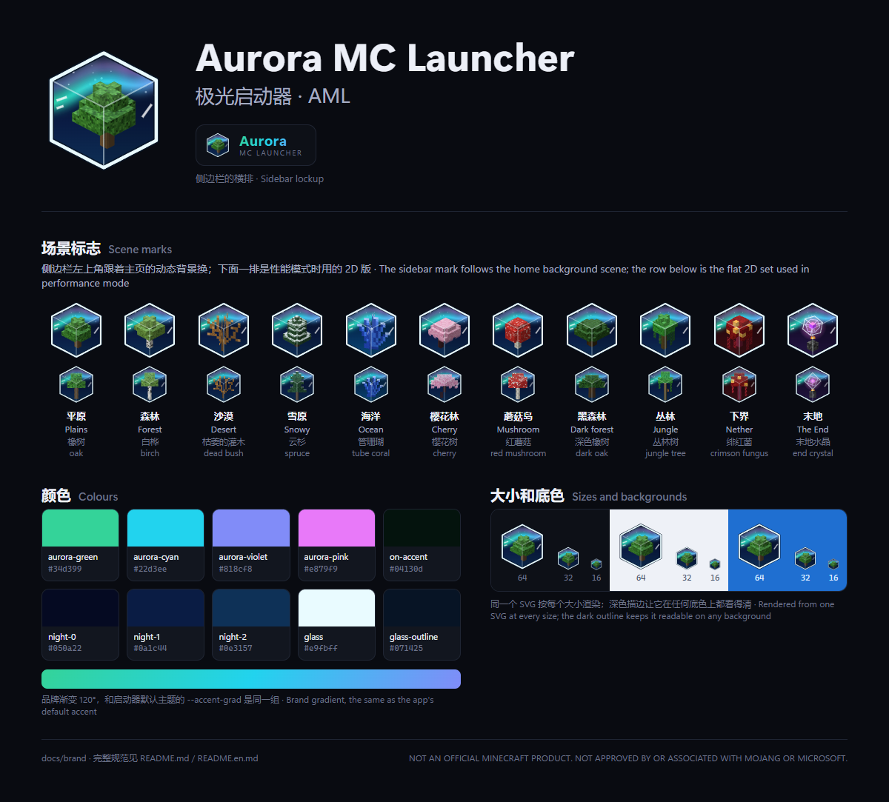

# 标志和视觉规范（VI）

[English](README.en.md)

极光启动器的标志、名字、颜色和字体怎么用。这一套和启动器界面是同一组颜色。

| 文件 | 是什么 |
|---|---|
| [`aml-mark.svg`](aml-mark.svg) | 主标志（3D 橡树） |
| [`aml-mark-2d.svg`](aml-mark-2d.svg) | 主标志的 2D 版 |
| [`../../src/renderer/img/brand/`](../../src/renderer/img/brand/) | 11 个场景标志 `scene-<场景>.svg` 和 2D 版 `scene-<场景>-2d.svg` |
| [`tokens.json`](tokens.json) | 颜色、字体、间距、圆角、阴影、标志大小，每一项都写了用在哪 |
| [`vi-sheet.png`](vi-sheet.png) | 上面这张总览图 |
| [`../../scripts/brand-icons.js`](../../scripts/brand-icons.js) | 从 `aml-mark.svg` 画出程序图标 `src/main/brand/icon.ico`（`npm run icons`） |

## 名字

- 全称写 **Aurora MC Launcher**，缩写 **AML**，中文名 **极光启动器**。三个都是正式名字，场合不同用不同的那个。以前叫过 Aurora Minecraft Launcher、Aurora Launcher，现在不再用（启动器只用旧名字来认以前建的数据文件夹）。
- 侧边栏只写 `Aurora`（`wordmark`）加标语 `MC LAUNCHER`（`tagline`）；README、发布页、窗口标题写全称；中文界面里提到自己写「极光启动器」或「启动器」。
- 不要把 Minecraft、Mojang、Microsoft 的名字或标志放进我们的标志和名字里。需要说明关系时用免责声明里那句：NOT AN OFFICIAL MINECRAFT PRODUCT. NOT APPROVED BY OR ASSOCIATED WITH MOJANG OR MICROSOFT.

## 标志的意思

一块玻璃方块，里面装着一片极光夜空，中间长着一棵树：**把极光装进方块里**。玻璃方块是 Minecraft 里最普通的方块，极光是名字，树是方块里的小世界。标志本身就是图标的外形（等距的六边形轮廓），没有圆角矩形的底板。

## 主标志

- 用 `aml-mark.svg`：3D 橡树。exe、窗口标题栏、任务栏、托盘、桌面快捷方式、README、发布页都用它，**默认一律用 3D**。
- 不要拿场景标志或 2D 版当程序图标。

## 侧边栏的场景标志

侧边栏左上角（34px）跟着主页的动态背景换：

| 场景 | 文件 | 里面的植物 |
|---|---|---|
| 平原；背景不是动态场景时（图片、纯色） | `scene-plains.svg`（和主标志一样） | 橡树 |
| 森林 | `scene-forest.svg` | 白桦 |
| 沙漠 | `scene-desert.svg` | 枯萎的灌木 |
| 雪原 | `scene-snowy.svg` | 挂雪的云杉 |
| 海洋 | `scene-ocean.svg` | 管珊瑚（方块里是水色 `ocean-0` ~ `ocean-2`） |
| 樱花林 | `scene-cherry.svg` | 樱花树 |
| 蘑菇岛 | `scene-mushroom.svg` | 巨型红蘑菇 |
| 黑森林 | `scene-darkforest.svg` | 深色橡树 |
| 丛林 | `scene-jungle.svg` | 丛林树 |
| 下界 | `scene-nether.svg` | 绯红菌（方块里是 `nether-0` ~ `nether-2`） |
| 末地 | `scene-end.svg` | 末地水晶（方块里是 `end-0` ~ `end-2`） |

- 换场景（包括骰子随机到的）时侧边栏标志跟着换；这张对应表是固定的，不随手换植物。
- 场景标志只出现在侧边栏，不用在别处。代码在 `src/renderer/js/brandlogo.js`。

## 性能模式的 2D 标志

性能模式打开时（主页背景只画一帧就停），侧边栏换成同一场景的**正面平画版**（`scene-<场景>-2d.svg`），关掉性能模式换回 3D。画面省下来，标志也「降」成 2D。2D 版只在这一处用。

## 画法

照着这些规则画，新加场景时也一样：

- **画布 256 × 256**，透明背景。玻璃方块是等距的立方体：半宽 108、顶面半高 56、侧面高 124（宽高比约 2:1，顶点在 (128, 10)）。
- **玻璃框**：先画 12px 宽的 `glass-outline`（85% 不透明），再在上面画 7px 宽的 `glass`；前面三条棱 3px、50% 不透明（树在玻璃后面，透过棱看得清）。左面两道、右面一道 5px 的白色斜反光。
- **里面的夜空**：`night-0` → `night-1`（60%）→ `night-2` 竖着的渐变，二十来颗星星；极光是一条模糊（9px）的光带，`aurora-green` → `aurora-cyan` → `aurora-violet` 横向渐变，光带上方有往上淡出的光幕（左边绿、右边紫），再上面一道 `aurora-violet` → `aurora-pink` 的淡光带。极光在树冠后面，照亮树冠顶边（`rim-light`）。
- **植物按游戏的生成规则一格一格摆**：橡树树干 5 格，叶子下两层 5×5、上两层 3×3，外圈的角随机少几块；云杉顶上一格尖，往下一层窄一层宽、越往下越宽；深色橡树 2×2 的粗干、又宽又扁的冠；红蘑菇顶上 3×3、四周三层围下来；枯萎的灌木和珊瑚是两片交叉的贴图（游戏里花草就是这样摆的：沿方块的两条对角线），从角上看一片正对、一片侧成一条线，太像平面，所以 3D 版再转 15°，主片几乎全宽，另一片斜着露出一窄条。
- **每格方块的面分 4×4 小格上色**，颜色从 `block-*` 那几族里随机挑；光照固定：顶面 100%、左面 80%、右面 62%。
- **不用游戏的贴图文件**，颜色和图案都是照游戏的感觉自己配的。

## 颜色

所有颜色和用法在 [`tokens.json`](tokens.json) 里，下面是规矩：

- 品牌渐变是 `aurora-green` → `aurora-cyan` → `aurora-violet`（120°），和启动器默认主题的 `--accent-grad` 是同一组。标志、名字、主按钮用这一组，不另配颜色。
- 深色是主场：品牌渐变、`aurora-green` 当字用时只放在 `bg` / `bg-1` / `bg-2` 上。
- 主按钮：`aurora-green` 底、`on-accent` 字。
- 状态色 `ok` / `warn` / `danger` / `info` 每次都配文字或图标出现，不只靠颜色区分。
- `aurora-pink` 和各场景的天色（`ocean-*`、`nether-*`、`end-*`）只在标志里用。

## 字体

- 标题和名字用 `display`（Segoe UI Variable Display，中文落到微软雅黑 UI），正文用 `text`，日志和参数用 `mono`。都是系统字体，不随启动器打包字体文件；其他系统按字体栈往后落。
- 名字 `Aurora` 用 `wordmark`：21px、800 粗、字距 0.4px、字填品牌渐变。标语 `MC LAUNCHER` 用 `tagline`：10px、字距 1.6px、全大写、`text-3`。
- 页面标题 `page-title`，分组标题 `section-title`，正文 `body`，说明 `hint`，代码 `code`。

## 标志和名字的组合

- **侧边栏**：34px 场景标志在左，右边 `wordmark`（只写 Aurora，字填品牌渐变）、下面 `tagline`；间距 `lockup-gap`，左右内边距 `brand-pad`。
- **横排**（发布页、宣传图）：主标志在左，右边全称用 `lockup-name`（`text` 色，不加渐变），下面中文名；标志和名字之间是标志宽度的 35%，名字的大写字母高度约为标志高度的一半。
- **竖排**（README 顶部、启动画面）：主标志在上居中，下面全称一行、中文名一行。
- 中文场合可以把 `Aurora` 换成「极光启动器」，字重、渐变不变，标语照旧写 `MC LAUNCHER`。
- 不要把名字放到标志上面或叠在标志上；不要改字重；渐变只给侧边栏的 Aurora，全称不加。

## 大小和留白

- 标志四周至少留 `mark-clear`（标志宽度的 1/8）。
- 用到的大小见 `tokens.json` 的 `iconSize`，最小 16px（托盘、标题栏）。程序图标的 ico 里有 16、20、24、32、40、48、64、256 八档，都是把同一个 SVG 按那个大小渲染出来的，不从大图缩小，也不另画简化版；16px 时看到的是玻璃框加一团树冠，这就够了。

## 背景

- 标志放在任何底色上都行：深色、浅色、蓝色桌面、照片都靠 `glass-outline` 描边看得清。
- 放在照片或复杂背景上时，四周留白翻倍，或者垫一块 `bg` 色的圆角面（`r-lg`）。

## 不要这样做

- 不要拉伸、倾斜、旋转标志，不要换玻璃框的颜色，**不要去掉深色描边**。
- 不要给标志外面再加圆角矩形底板、外发光或投影（侧边栏那个 34px 的轻投影除外）。
- 不要把苦力怕的脸、草方块原贴图、Minecraft 字标之类游戏和 Mojang 的东西加进标志。
- 不要在标志旁边写「官方」「Minecraft 官方启动器」之类的话。
- 不要用 2D 版当程序图标，也不要在性能模式以外的地方用 2D 版。
- 不要自己换场景对应的植物；要加新场景，先按「画法」画一个，再加进对应表。

## 文案的语气

- 用平常说话的中文，对玩家说「你」。先说现在是什么情况，再说下一步怎么做，永远给一个关掉或返回的出路。例：「这台电脑配置比较低，也可以考虑打开下面的『性能模式』（连背景、音乐、动画一起关掉）。」
- 界面上的名字用「」括起来，菜单路径用 → 连：「设置 → 启动器 → 性能模式」。
- 中文和英文、数字之间空一格：「MC 百科」「Mod 管理」「4 GB」。
- 不用表情符号；版本号写全；更新日志按玩家能感觉到的变化写，不写内部实现。

## 已知问题

- 浅色主题下，侧边栏的 `Aurora` 品牌渐变字在 `bg-1` 上只有约 1.7:1（`aurora-green` 那一端），不够看清。启动器现在就是这样，这里照实记下；以后改的话，浅色主题用更深的一组渐变。
- `text-3` 两个主题都不够 4.5:1（深色 4.2:1，浅色 2.75:1），只能用于不读也不影响操作的提示。
